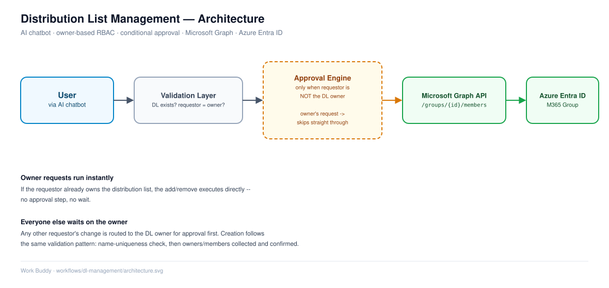

# Distribution List (DL) Management Automation (Creation & Modification | Microsoft Graph)

## Overview

This solution automates the lifecycle management of Distribution Lists (DLs) using an AI-driven chatbot integrated with Microsoft Graph API.

It supports:

* DL Creation
* Adding users to DL
* Removing users from DL
* Owner-based access control
* Approval workflow for unauthorized requests

---

## Problem Statement

Manual DL management leads to:

* Delays in request fulfillment
* High service desk dependency
* Unauthorized modifications
* Lack of validation and governance

---

## Solution

An AI chatbot-driven automation that:

* Validates DL existence
* Verifies user permissions
* Supports approval-based workflows
* Automates DL creation and modification via Microsoft Graph API

---

# 🔹 Use Case 1: DL Modification (Add / Remove Members)

## High-Level Workflow

1. User requests DL modification
2. Bot asks for DL name
3. System validates DL existence via Graph API
4. User confirms DL
5. Bot asks for member to add/remove
6. System checks if requestor is DL owner
7. If owner:

   * Action executed directly
8. If not owner:

   * Approval request sent to DL owner
9. Upon approval → action executed

---

## Detailed Workflow

### Step 1: DL Validation

* User provides DL name
* Bot queries Microsoft Graph

```id="dl01api"
GET /groups?$filter=mail eq '{DLName}'
```

**Validation:**

* If DL not found → prompt user to re-enter
* If found → ask for confirmation

---

### Step 2: Member Input

* User specifies:

  * Add user OR remove user
* Bot captures target user identity

---

### Step 3: Owner Verification

* Bot retrieves DL owner details

```id="dl02api"
GET /groups/{group-id}/owners
```

* Compares:

  * Requestor vs DL owner

---

### Step 4: Conditional Execution

#### Case 1: Requestor is Owner

* Direct execution via Graph API

```id="dl03api"
POST /groups/{group-id}/members/$ref
```

OR

```id="dl04api"
DELETE /groups/{group-id}/members/{user-id}/$ref
```

---

#### Case 2: Requestor is NOT Owner

* Approval request sent to DL owner
* Owner approves/rejects

**If approved:**

* Action executed

**If rejected:**

* Bot notifies requestor

---

# 🔹 Use Case 2: DL Creation

## High-Level Workflow

1. User requests DL creation
2. Bot asks for DL name
3. System validates uniqueness
4. Bot collects:

   * Description
   * Owners
   * Members
5. Bot confirms details
6. DL created via Graph API

---

## Detailed Workflow

### Step 1: DL Name Validation

* User provides DL name

Naming convention:

```id="dlname"
{DLName}_2025@domainname.com
```

* Bot checks existence:

```id="dl05api"
GET /groups?$filter=mail eq '{DLName}'
```

**Validation:**

* If exists → ask user to re-enter
* If not → proceed

---

### Step 2: Collect DL Details

Bot collects:

* DL Description
* Number of Owners (1 or 2)
* Owner details (email/name)
* Members:

  * Single OR multiple

---

### Step 3: Input Validation

* Validate:

  * User existence
  * Email formats
  * Duplicate entries

---

### Step 4: User Confirmation

Bot displays summary:

* DL Name
* Description
* Owners
* Members

User confirms:

* Yes → proceed
* No → restart/edit

---

### Step 5: DL Creation

Create M365 Group via Graph API:

```id="dl06api"
POST /groups
```

```json id="dl07json"
{
  "displayName": "DL Name",
  "mailEnabled": true,
  "mailNickname": "dlname_2025",
  "securityEnabled": false,
  "groupTypes": ["Unified"]
}
```

---

### Step 6: Add Owners & Members

Owners:

```id="dl08api"
POST /groups/{group-id}/owners/$ref
```

Members:

```id="dl09api"
POST /groups/{group-id}/members/$ref
```

---

## Architecture



User → Chatbot → Validation Layer → Approval Engine → Microsoft Graph API → Azure Entra ID

---

## Technology Stack

* Azure Entra ID
* Microsoft Graph API
* AI Chatbot Platform (Aisera / Moveworks / Copilot/ other similar services)
* Approval Workflow System
* REST APIs

---

## Key Features

* End-to-end DL lifecycle automation
* Owner-based RBAC enforcement
* Approval workflow for governance
* Input validation and error handling
* Scalable and reusable design

---

## Security Considerations

* Validate requestor identity
* Restrict unauthorized modifications
* Secure API authentication (OAuth 2.0)
* Audit logging for changes

---

## Failure Handling

* DL not found → retry
* User not found → re-entry
* Approval timeout → notify user
* API failure → retry mechanism

---

## Reusability

Supports multiple triggers:

* Chatbot
* Service portal
* API-based automation
* ITSM workflows

---

## Future Enhancements

* Bulk DL operations
* Dynamic group support
* Role-based access control expansion
* Integration with governance tools

---
