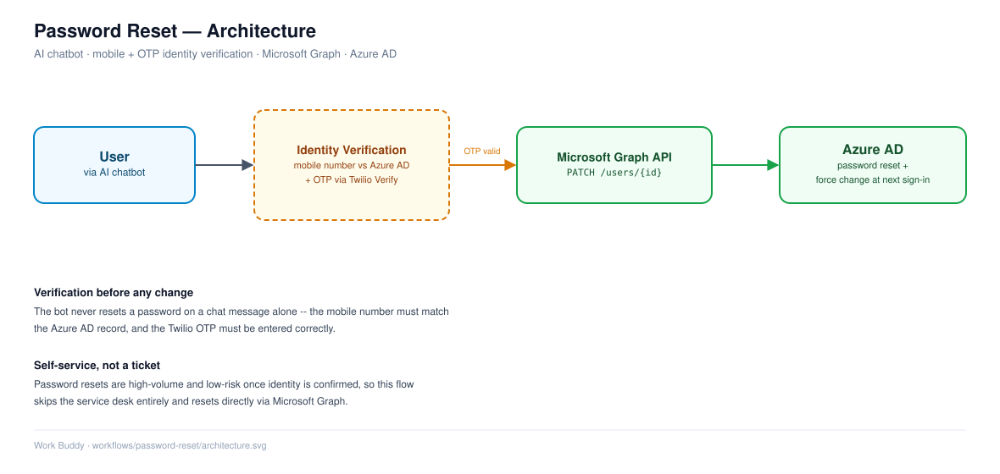

# Password Reset Automation (AI-driven Self-Service)

## Overview

This solution enables users to securely reset their Active Directory (AD) password through an AI-powered chatbot.
The process eliminates manual service desk intervention by leveraging identity verification and automated password reset via Microsoft Graph API.

---

## Problem Statement

Password reset requests are one of the most frequent service desk tickets, leading to:

* High operational workload
* Increased resolution time
* User productivity loss

---

## Solution

An AI-driven chatbot automates the password reset process by:

* Verifying user identity using registered mobile number
* Sending OTP via Twilio for secure authentication
* Resetting password using Microsoft Graph API
* Enforcing password change at next login

---

## High-Level Workflow

1. User initiates request: *"I need to reset my password"*
2. Bot prompts user to enter registered mobile number
3. System validates entered number against Azure AD
4. If incorrect:

   * Bot prompts user to retry
5. If correct:

   * OTP is sent via Twilio
6. User enters OTP
7. OTP is validated using Twilio verification service
8. If OTP is valid:

   * Password is reset to default value
   * User is required to change password at next login
9. Bot confirms successful reset

---

## Detailed Workflow

### Step 1: User Interaction

* User initiates password reset request via chatbot

### Step 2: Identity Verification (Mobile Number)

* Bot prompts user to enter registered phone number
* System retrieves user details via Microsoft Graph API
* Entered number is validated against stored AD attributes

**Failure Handling:**

* If mismatch → user is prompted to re-enter number

---

### Step 3: OTP Generation & Verification

* OTP is generated and sent using Twilio API
* User enters received OTP
* OTP is validated via Twilio Verify API

**Failure Handling:**

* Invalid OTP → retry mechanism

---

### Step 4: Password Reset Execution

* Upon successful OTP validation:

  * Password is reset using Microsoft Graph API
  * Default password is assigned
  * `ForceChangePasswordNextSignIn = true` is enforced

---

## Architecture



User → Chatbot → Identity Verification → OTP Service (Twilio) → Automation API → Microsoft Graph → Azure AD

---

## Technology Stack

* Azure Active Directory (Azure AD)
* Microsoft Graph API
* Twilio (OTP Service)
* AI Chatbot Platform (Aisera / Moveworks / Copilot / other similar services)
* REST APIs / Automation Layer

---

## Sample API Logic

### Get User Details

```
GET https://graph.microsoft.com/v1.0/users/{userPrincipalName}
```

---

### Reset Password

```
PATCH https://graph.microsoft.com/v1.0/users/{id}
```

```json
{
  "passwordProfile": {
    "password": "NewSecurePassword@123",
    "forceChangePasswordNextSignIn": true
  }
}
```

---

## Key Features

* Secure multi-step identity verification
* OTP-based authentication
* Fully automated password reset
* Reduced dependency on service desk
* Scalable and reusable architecture

---

## Security Considerations

* No sensitive data stored in logs
* OTP validation handled via secure provider
* API authentication via OAuth 2.0
* Rate limiting for retry attempts

---

## Reusability

This solution can be triggered via:

* Chatbot (primary interface)
* REST API
* Self-service portal
* Automation workflows

---

## Future Enhancements

* Multi-factor verification (email + OTP)
* Biometric authentication integration
* Risk-based authentication
* Audit logging by creating a ticket and reporting dashboard

---
