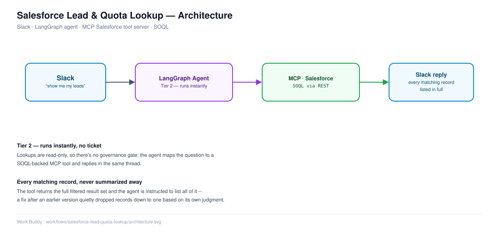

# Salesforce Lead & Quota Lookup (Tier 2, Instant)

## Overview

A sales rep or manager asks Work Buddy, in plain English, about open leads or quota attainment, and gets an answer straight from Salesforce — no logging into Salesforce, no report to run. This use case shows Work Buddy isn't an IT-only tool: the same agent, same Slack channel, and same MCP pattern extend naturally into sales.

## Problem Statement

* Checking lead status or quota attainment normally means opening Salesforce, navigating to the right report or list view, and applying filters by hand.
* Reps often want a quick answer ("what leads haven't I touched in 45 days?") without building or saving a report for it.
* Managers want quota attainment on demand, not only from a dashboard they have to go find.

## Solution

Work Buddy exposes Salesforce as an MCP tool server. The agent:

* Takes the natural-language question from Slack
* Maps it to the right SOQL-backed tool (lead status, sales quota)
* Runs the query against Salesforce
* Returns every record the query matched, formatted for Slack

## High-Level Workflow

1. User asks a question in Slack (e.g. "show me my open leads" or "what's my quota attainment this quarter?")
2. Agent identifies the Salesforce intent and selects the matching MCP tool
3. Tool server runs the SOQL query against Salesforce
4. Results are returned to the agent
5. Agent replies in the same Slack thread with the full result set

## Detailed Workflow

### Step 1: Intent & Tool Selection

* The agent's system prompt and tool descriptions let it pick between lead-status and quota-attainment tools (and others) based on the question's wording.

### Step 2: Query Execution

* The MCP tool server runs a parameterized SOQL query, e.g. filtering leads by owner, status, and last-modified date.

### Step 3: Result Handling

* The tool returns the full, already-filtered record set.
* The agent is instructed to list every record returned — not to re-filter or summarize away records based on its own judgment — since the query has already applied the correct filtering logic.

### Step 4: Reply Formatting

* Results are rendered as a numbered/bulleted list (not a markdown table — Slack's `mrkdwn` doesn't render pipe-tables), one entry per record with its key fields (name, status, last modified, etc.)

## Architecture

Slack → LangGraph agent → MCP (Salesforce tool server) → Salesforce REST/SOQL API → back to agent → Slack reply

## Technology Stack

* Salesforce (SOQL queries via REST)
* MCP tool server (n8n-hosted today)
* LangGraph + LangChain agent
* Slack (`slack_bolt`)

## Key Features

* Natural-language access to lead status and quota data
* No separate report-building or dashboard navigation
* Same conversational interface used for IT requests

## Known Issue Being Tracked

* An earlier version of the agent under-reported multi-record results — the tool returned all matching leads correctly, but the model summarized them down to a single record based on its own relevance judgment. Root cause confirmed to be model-side (not the SOQL query or n8n), fix is a system-prompt rule requiring every returned record to be listed.

## Future Enhancements

* Extend to additional Salesforce objects (opportunities, accounts)
* Add trend/comparison questions ("how does this compare to last quarter?")
