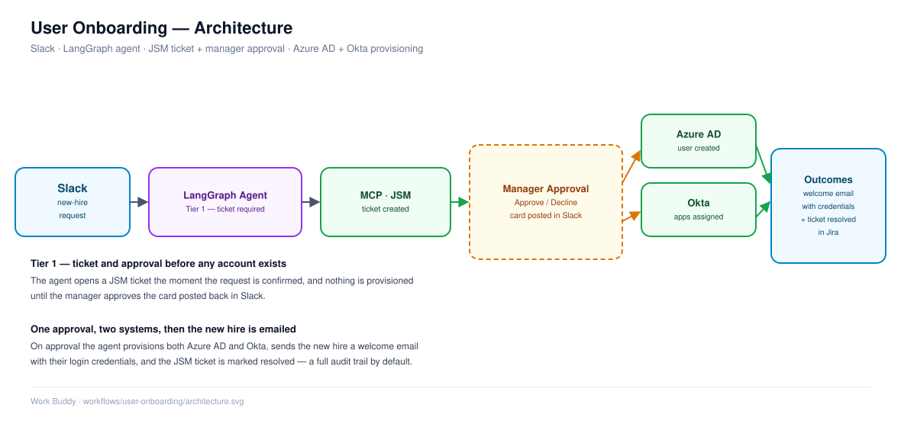

# User Onboarding (Tier 1, Ticket + Approval)

## Overview

End-to-end provisioning for a new hire, kicked off from a Slack conversation with Work Buddy, routed through a ticket and manager approval, and completed across the connected systems once approved. This is the flagship Tier 1 flow: unlike status checks and unlocks, onboarding changes who can access what, so it goes through governance rather than running instantly.

## Problem Statement

* New-hire provisioning normally spans multiple consoles (identity provider, directory, CRM, ticketing) and several people.
* Manual handoffs between requester, approver, and whoever does the provisioning introduce delay and inconsistency.
* Sensitive account-creation actions need an audit trail, not just a chat log.

## Solution

Work Buddy collects the onboarding request conversationally, opens a Jira Service Management (JSM) ticket, routes it for manager approval, and — once approved — provisions the new user across the connected systems (Okta, Azure AD, and any others configured), confirming back in Slack when it's done.

## High-Level Workflow

1. Requester describes the new hire to Work Buddy in Slack (role, systems needed, manager)
2. Agent opens a JSM ticket capturing the request
3. Ticket is routed to the manager for approval
4. On approval, the agent provisions access across the relevant systems
5. Agent confirms completion back in the original Slack thread, with the ticket as the audit record

## Detailed Workflow

### Step 1: Request Capture

* Agent gathers the details it needs (new hire identity, systems/role) through the Slack conversation.

### Step 2: Ticket Creation

* A JSM ticket is created via the JSM MCP tool, holding the request details and serving as the audit trail required for a Tier 1 action.

### Step 3: Approval Routing

* The ticket is routed to the requester's manager for approval before any provisioning happens — this is the governance gate that distinguishes Tier 1 from the instant Tier 2 actions.

### Step 4: Provisioning

* Once approved, the agent calls the relevant MCP tools (Okta, Azure AD, etc.) to create/configure the new user's access.

### Step 5: Confirmation

* Work Buddy replies in the originating Slack thread confirming what was provisioned, with the ticket number for reference.

## Architecture

Slack → LangGraph agent → MCP (JSM tool server) → ticket created → manager approval → MCP (Okta/Azure AD tool servers) → provisioning → Slack confirmation

## Technology Stack

* Jira Service Management (ticketing + approval)
* Okta, Azure AD (provisioning targets)
* MCP tool servers (n8n-hosted today)
* LangGraph + LangChain agent
* Slack (`slack_bolt`)

## Key Features

* Single conversational entry point for a multi-system process
* Manager approval gate with a ticket-based audit trail
* Same agent and interface as the instant Tier 2 flows — governance is attached to the action, not a separate tool

## Security Considerations

* Provisioning only executes after explicit manager approval is recorded on the ticket
* No new-account action happens outside the ticketed/approved path

## Future Enhancements

* Expand provisioning coverage to additional systems as they're connected
* Add status polling so the requester sees ticket/approval state without asking
